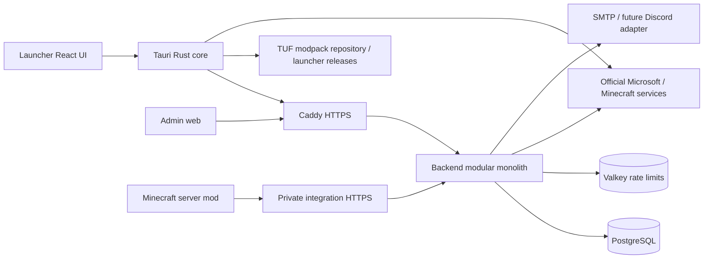
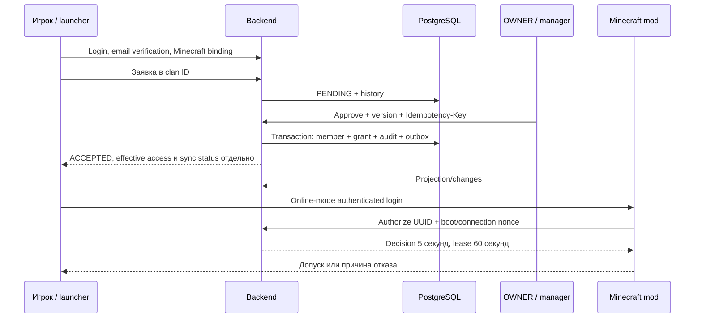

# AnimeOnCraft — архитектура MVP

## Текущее состояние — 20.10.2026

Ниже под этим разделом — исходная спецификация этапа 1 (09.10) и последующие уточнения; она остаётся основой границ доверия и инвариантов. Фактическая архитектура сейчас:

- **Компоненты.** Launcher (React + Tauri 2/Rust, 0.7.38), backend (NestJS + Fastify, PostgreSQL через Prisma и raw SQL, Valkey для лимитов), веб-админка, собственный мод NeoForge 1.21.1 на сервере и клиенте, публичный сайт на GitHub Pages, один VPS. Игровой вход — через аккаунт AnimeOnCraft (D-0057), не через Microsoft.
- **Кланы — реестр, а не фиксированный набор** (этап 1 World Design). Официальные кланы и их цвета задаются в `minecraft/server/clan-world.json`; мод регистрирует их в `ClanCodes` при старте сервера (до 64), клиент проверяет только формат кода. В БД — `clans.color`, в API — `ClanSummary.color`; лаунчер берёт цвет из API с запасным цветом для неизвестных кодов. Подробно: [CLAN_REGISTRY_STAGE1.md](docs/operations/CLAN_REGISTRY_STAGE1.md).
- **Модель мира в БД** (этап 2). Профиль `minecraft/server/world-config/world.toml` → `world:import` (валидация, идемпотентный версионный импорт, аудит) → таблицы `world_catalog` (один активный), `world_regions`, `region_borders`, `strategic_points`, `resource_sites`, `region_connections`, владение площадками, события захвата, история выдач, маркеры. Код — `apps/backend/src/world-catalog/`. Публичное чтение — `GET /api/v1/world/map` и `/api/v1/world/points` (`modules/world-map`), их же разрешает Rust `public_api.rs`; в лаунчере вкладка «Карта» (`world-map.tsx`). Подробно: [WORLD_MODEL_STAGE2.md](docs/operations/WORLD_MODEL_STAGE2.md).
- **Генерация мира государств** (этап 3, только тестовые миры). Генератор остаётся ванильным `NoiseBasedChunkGenerator` с модами; форму материка и климат регионов задают маски из датапака мира `animeoncraft-states` (функция плотности `animeoncraft:mask`), асимметрию руд — `animeoncraft:region_weight` и biome modifier `region_weighted_features`. Без датапака мод ничего не меняет, поэтому текущий мир не затронут. Подробно: [WORLDGEN_STAGE3.md](docs/operations/WORLDGEN_STAGE3.md), [WORLDGEN_PIPELINE.md](docs/WORLDGEN_PIPELINE.md).
- **Захват и ресурсные точки** (этап 4, тестовый сервер). Backend — источник истины: объявление, фазы, владельцы, таймеры защиты и аренды, награды и история (`apps/backend/src/capture/`, маршруты `integration/v1/capture/*` с ключом сервера). Мод только измеряет бой (присутствие, убийства, прогресс), шлёт снимки и итог через долговременный outbox, восстанавливает ямы и тайники. Правила — `capture-rules.toml`, импортируются вместе с каталогом мира. Подробно: [CAPTURE_STAGE4.md](docs/operations/CAPTURE_STAGE4.md).
- **Постройки и дороги** (этап 5, тестовый мир). Раскладка `aoc/layout.json` генерируется из blueprint вместе с каталогом; мод строит объекты в палитрах регионов (или NBT-шаблоны, если они есть), прокладывает дороги и не даёт случайным структурам появляться на площадках точек. Подробно: [LAYOUT_STAGE5.md](docs/operations/LAYOUT_STAGE5.md).
- **Ещё не реализовано:** перевод войн на общий движок (этап 7), постройки и дороги (5), предгенерация (6), переход рабочего мира (7) — см. [план миграции](docs/WORLD_DESIGN.md#план-миграции). Этапы 1–5 лежат в ветке `world-design-2026-10-20` и не выпущены.

Шпаргалка по командам и правилам для агента — [CLAUDE.md](CLAUDE.md).

Актуальный D-0063 (2026-10-15): основной локальный client/server/API подключены к PLAY, мир сохранён и проверен после restart. [Как запустить основной мир](docs/operations/LOCAL_GAME_START.md), [передача работы](START_HERE.md). Удалённый вход/HTTPS и первый человеческий вход в основной мир ещё проверяются.

> На 2026-10-14 текущий объём и команды заданы в [лаунчере для друзей](docs/operations/FRIENDS_LAUNCHER.md), 0.7.20. Требования ниже к email verification/рассылке и сложному updater сохранены как история, не блокируют этап 7. Обычный игрок входит по логину/паролю, OWNER восстанавливает пароль вручную на сохранённую почту; административная MFA сохраняется.

> Уточнение 2026-10-15, D-0057: часть друзей играет без купленной Minecraft Java. Выбран [игровой вход через AnimeOnCraft](docs/architecture/FRIENDS_GAME_LOGIN.md). Историческое требование online-mode/Microsoft binding ниже заменено этим решением; код допуска ещё предстоит согласованно обновить на этапе 10. Локальный offline-сервер этапа 9 закрыт на 127.0.0.1 и не является готовой защитой пользовательских аккаунтов.

Версия: 0.1.0-architecture. Дата: 2026-10-09. **Этап 1: проектирование завершено; реализации и runtime-проверки ещё нет.** Подробная спецификация далее заменяет предварительное видение. Вводные ограничения Discovery сохранены ниже для контекста.

## Постоянные ограничения из ТЗ

- Backend является authoritative source для кланов, заявок, членства и прав доступа.
- Кланы представлены данными. Только OWNER создаёт официальные кланы; менеджер ограничен назначенным кланом.
- SCAM, NYA, AKUMA, ZXC — bootstrap data, не закрытый набор значений.
- Регистрация аккаунта не даёт Minecraft access. Все критические permissions проверяются server-side.
- Не использовать доверие к nickname, launcher flag, Discord role или переданному clan_id как основание доступа.
- Secrets не входят в Git; все административные действия аудируются.

## Предварительные компоненты

```text
Launcher UI ── Native core ───────┐
                                │ HTTPS / versioned API
Admin web ──────────────────────┤
                                v
                          Backend modules ─── PostgreSQL
                                ^
                                │ limited integration API
                          Server-side mod
                                │
                          Minecraft server / world

Launcher native core ── HTTPS ── signed release / modpack artifacts
Backend events ── future adapter ── Discord notifications
```

Схема показывает связи, а не обязательную последовательность сетевых запросов. БД не открывается launcher, admin или игровому серверу напрямую. Файловое хранилище отделено от бизнес-API.

Модульный monolith: identity/auth, users, clans/membership/applications, access/bans, news/releases, integration/telemetry, admin/audit. Подробные границы и зависимости этапа 1 зафиксированы далее; предварительная схема выше показывает только основное направление связей.

## Предварительные границы доверия

| Граница | Требование к будущему проекту |
| --- | --- |
| UI → API | Untrusted input; authentication, validation и authorization на каждом действии |
| UI → native Rust | Ограниченные capabilities и проверки каждой команды; удалённый контент не получает native privileges |
| API → DB | Ограничения целостности и транзакции; миграции проверяются до release |
| Minecraft → integration API | Отдельная service identity и scope; телеметрия не даёт права менять роли |
| Игрок → Minecraft | Проверяемая identity плюс действующий допуск; alternate launcher не обходит проверку |
| Hosting → launcher | Доверенность manifest/артефактов подтверждается подписью; hash определяет целостность файлов |
| Backend → Discord | Уведомление не становится командой для выдачи членства |

Native launcher и service credential на игровом сервере требуют разных угроз и scopes. Владение service credential не должно давать OWNER. DB и игровой мир остаются разными источниками данных с разной ответственностью.

## Зафиксированная топология MVP



Один сервер и API, private PostgreSQL/Valkey. Public gateway не проксирует integration paths; отдельный listener требует service credential и private network/VPN. Minecraft TCP-порт отделён от HTTPS. DB никогда не доступна клиентам напрямую.

## Принятый стек

| Часть | Решение | Граница проверки |
| --- | --- | --- |
| Backend | Node.js 24 LTS, TypeScript, NestJS 12 / Fastify 5 | Registry metadata проверена; build на этапе 2 |
| DB | PostgreSQL 17; Prisma CLI/client **7.10.0 одной версии**, SQL migrations | RC Prisma 8 не использовать; SQL constraints/locks обязательны |
| Rate limits | Valkey 8.1, private ACL/AOF storage | Не хранит authoritative membership/sessions/access |
| UI/workspace | React 19, Vite 8, pnpm 12 | Patch versions/lockfiles на этапе 2 |
| Desktop | Tauri 2, Rust stable/MSVC, Windows x64 first | Plugins/MSRV pin и native build ещё впереди |
| Java core | JDK 21 для build, Java `--release 17`, Gradle Wrapper | Без loader API; server runtime ещё не выбран |
| Modpack update trust | TUF 1.x через готовый Rust client, кандидат `tough` | Crypto/metadata verification не писать вручную |
| Self-update | Tauri updater + Windows installer signature | Отдельные ключи/канал от modpack |
| Deploy | Linux, Compose, Caddy, persistent volumes | Capacity и production проверяются на этапе 16 |

Minecraft/loader/server Java/mods — этап 8. Стек принят как техническое решение для skeleton; engine/peer checks не заменяют сборку. [Источники и registry observations](docs/architecture/SOURCES.md).

## Модули и границы зависимостей

| Модуль | Владеет | Разрешённые связи |
| --- | --- | --- |
| Identity | users, passwords/MFA, sessions/tokens, Minecraft links | Persistence, audit, external identity adapter |
| Clans | clans, manager roles/assignments, members, applications/history | Identity references, Access command port, audit/outbox |
| Access | whitelist grants, bans, access policy/epoch | Identity/membership read ports, audit/outbox |
| Content | news, sanitized media | Actor authorization, audit |
| Releases | Immutable releases/channels/manifest references | Audit; нет private signing keys |
| Integration | service principals, boots, admission/leases, presence/stats | Access/Clans read ports, telemetry persistence |
| Operations | fixed commands, typed settings, health | Scoped command port, audit/outbox |
| Delivery | outbox/retry, future SMTP/Discord | Только заданные consumer ports |

Application services координируют одну DB transaction через unit of work. Внешний HTTP/SMTP/Discord не выполняется под DB locks. Межмодульные commands идут через ports, не чужой repository; composition root связывает read/command ports, взаимные Nest module imports запрещены. `packages/contracts`: OpenAPI 3.1, JSON Schema, examples/golden fixtures. UI/Rust/Java не импортируют ORM entities или TS domain code. UI package содержит только tokens/components. Не создавать отдельные microservices для перечисленных модулей.

## Основные инварианты

1. Максимум один OWNER; назначение через защищённую local procedure, не обычный API.
2. Один active membership и один VERIFIED Minecraft account на user. UUID не принадлежит двум users.
3. Менеджер — текущее назначение конкретному clan. Approval actor не равен applicant; OWNER имеет отдельное audited direct admission.
4. Application decision, membership, grant, audit, access epoch и outbox — одна transaction.
5. Ban/inactive user имеет приоритет перед grants и OWNER. OWNER status не даёт game access автоматически.
6. Minecraft проверяет online-mode GameProfile и backend admission. Launcher brand не credential.
7. Integration service не назначает роли, memberships или whitelist grants.
8. DB commit — истина; delivery как минимум один раз, consumers идемпотентны.
9. TUF подтверждает trust modpack; Tauri updater — executable launcher; hashes проверяют file integrity.
10. При потере backend новые соединения не допускаются; существующие имеют ограниченную lease.

## Сквозной workflow



Заявку можно подать после email verification до Minecraft binding; принятие без VERIFIED UUID даёт `IDENTITY_REQUIRED`, не game access. Vanilla whitelist — projection: stale allow не обходит mod check. Разрешённый игрок может подключиться другим совместимым клиентом; отдельного требования launcher exclusivity нет.

## Access policy и defaults кланов

`ALLOW = user ACTIVE AND email VERIFIED AND Minecraft VERIFIED AND no active ban AND (active membership grant OR active OWNER grant)`. До user predicate действуют глобальные gates: restore hold/maintenance закрыты, service boot/protocol supported. Membership grant требует ACTIVE member и not ARCHIVED clan. Expiry определяется backend clock. Недоступная DB означает DENY/503. Restore hold также блокирует manager writes до operator reconciliation.

`enabled=false` закрывает новые applications/approvals и promotion, сохраняет существующие memberships/access. Archive прекращает members/manager assignments/pending applications/membership grants одной transaction; owner grants остаются явными исключениями, UI обязан их показать. Unarchive не восстанавливает старые права. Исторические кланы физически не удаляются.

В MVP нет автоматического transfer: leave → новая application; одна PENDING глобально. После reject новый application в тот же clan через 24 часа (configurable). Менеджер не меняет свои права и не исключает себя/другого действующего менеджера; этим управляет OWNER. Эти reversible defaults приняты для реализации, gameplay/raid/border не определяют.

## Подробные спецификации

- [DATA_MODEL.md](docs/architecture/DATA_MODEL.md) — таблицы, constraints, transitions, locks и transactions.
- [AUTH_SECURITY.md](docs/architecture/AUTH_SECURITY.md) — user/OWNER/MFA, CSRF, identity и service auth.
- [API_CONTRACTS.md](docs/architecture/API_CONTRACTS.md) — маршруты, DTO, errors и idempotency.
- [MINECRAFT_PROTOCOL.md](docs/architecture/MINECRAFT_PROTOCOL.md) — admission, revocation, outages, projections и stats.
- [UPDATES.md](docs/architecture/UPDATES.md) — trust/distribution/install/repair и launch boundary.
- [OPERATIONS.md](docs/architecture/OPERATIONS.md) — deployment, secrets, logs и backup/restore.
- [THREAT_MODEL.md](docs/architecture/THREAT_MODEL.md) — threats, assumptions и verification plan.
- [SKELETON_PLAN.md](docs/architecture/SKELETON_PLAN.md) — точный объём этапа 2.

Architecture specification не является доказанной реализацией. Текущий development implementation: этапы0–3, auth4, Clan system5 и Admin panel6 ([ADMIN_PANEL.md](docs/operations/ADMIN_PANEL.md), [CLANS.md](docs/operations/CLANS.md), [AUTHENTICATION.md](docs/operations/AUTHENTICATION.md)). Positive HTTPS admin/native UI, provider/inbox/break-glass, loader admission, performance/restore требуют испытаний. Остановка перед7 Launcher MVP по новой команде; production/PLAY закрыты.
